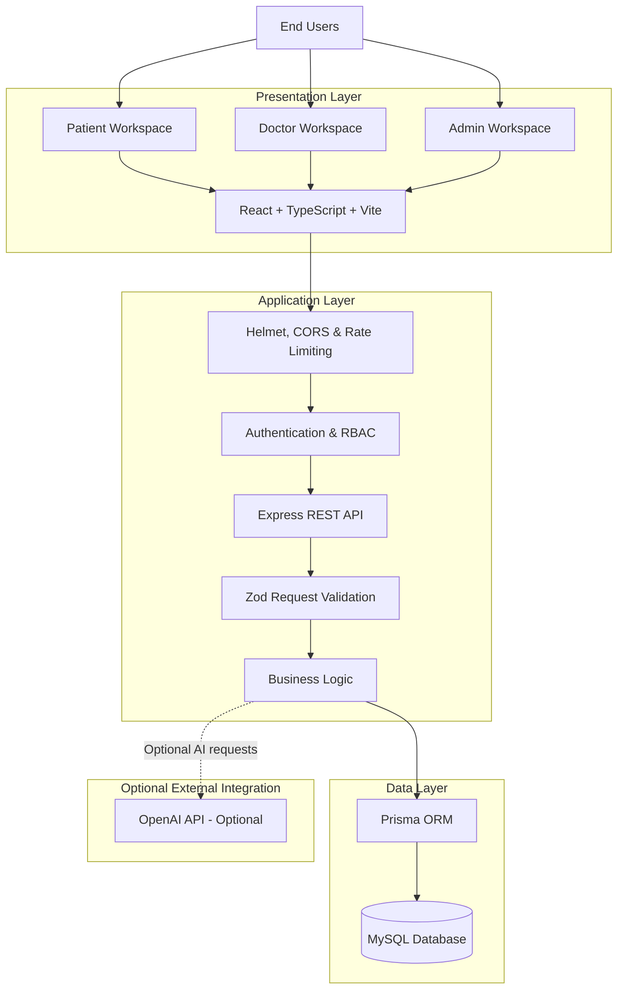
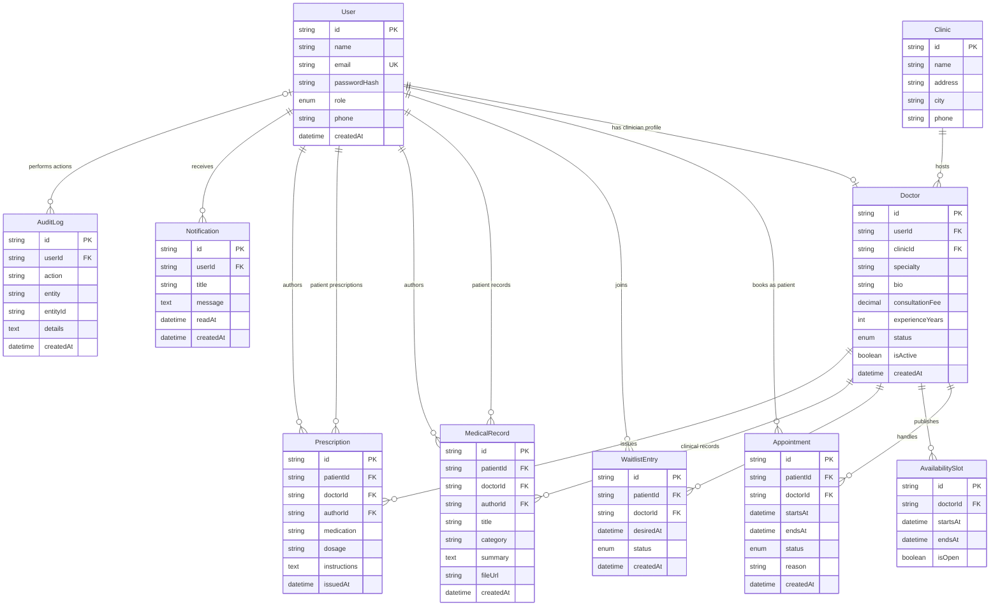

# MediCore 2.0 — Technical Documentation

## 1. System Architecture

MediCore follows a modular full-stack architecture with a React-based client application, an Express REST API and a MySQL relational database managed through Prisma ORM.

### Architecture Overview



### Technology Stack

| Layer | Technology | Responsibility |
|---|---|---|
| Frontend | React 18 | User interface and component architecture |
| Language | TypeScript | Type safety and maintainability |
| Build Tool | Vite | Development server and production bundling |
| Styling | CSS | Responsive application interface |
| Backend | Node.js | Server-side JavaScript runtime |
| API | Express.js | REST API and request handling |
| ORM | Prisma | Database access and schema management |
| Database | MySQL | Relational data persistence |
| Authentication | JWT | Authenticated API access |
| Password Security | bcryptjs | Password hashing |
| Validation | Zod | Request payload validation |
| Security | Helmet, CORS, Express Rate Limit | HTTP security and request protection |

### Request Lifecycle

1. A user interacts with the React frontend.
2. The frontend sends an HTTP request to the Express API.
3. Authentication middleware validates the JWT where authentication is required.
4. Role-based middleware checks the user's permissions.
5. Zod validates incoming request data.
6. Application logic processes the request.
7. Prisma communicates with MySQL.
8. The API returns a JSON response to the frontend.

---

## 2. Database Design — Entity Relationship Diagram

MediCore uses a relational database design to maintain relationships between users, clinicians, clinics, appointments and clinical records.

### ER Diagram



### Database Design Principles

- Primary keys use generated unique identifiers.
- User email addresses are unique.
- Doctor accounts are associated with user accounts.
- Each doctor belongs to a clinic.
- Appointments connect patients and doctors.
- Clinical records and prescriptions maintain patient, doctor and author relationships.
- Notifications are associated with individual users.
- Audit logs maintain a record of administrative and application events.
- Foreign key constraints maintain referential integrity.

### Enumerations

**User Roles**
- PATIENT
- DOCTOR
- ADMIN

**Appointment Status**
- BOOKED
- CONFIRMED
- COMPLETED
- CANCELLED
- NO_SHOW

**Doctor Status**
- PENDING
- ACTIVE
- SUSPENDED

**Waitlist Status**
- WAITING
- NOTIFIED
- BOOKED
- EXPIRED

---

## 3. REST API Documentation

**Base URL**

```text
http://localhost:8080/api
```

The backend exposes REST endpoints using Express.js.

### Authentication

| Method | Endpoint | Access | Description |
|---|---|---|---|
| POST | `/auth/register` | Public | Register a patient |
| POST | `/auth/login` | Public | Authenticate a user |

Registration creates a Patient account. Doctor accounts are created through the Admin workflow.

### Doctor Directory and Administration

| Method | Endpoint | Access | Description |
|---|---|---|---|
| GET | `/doctors` | Public | List active doctors |
| GET | `/admin/doctors` | Admin | View clinician directory |
| POST | `/admin/doctors` | Admin | Create a doctor account |
| PATCH | `/admin/doctors/:id/status` | Admin | Change doctor account status |
| GET | `/admin/metrics` | Admin | Retrieve platform metrics |
| GET | `/admin/audit` | Admin | View administrative audit events |

### Appointment Management

| Method | Endpoint | Access | Description |
|---|---|---|---|
| GET | `/appointments` | Authenticated | Retrieve role-filtered appointments |
| POST | `/appointments` | Patient | Book an appointment |
| PATCH | `/appointments/:id/cancel` | Authorised user/Admin | Cancel an appointment |
| PATCH | `/appointments/:id/status` | Doctor/Admin | Update appointment status |
| PATCH | `/appointments/:id/reschedule` | Patient | Reschedule an appointment |

### Availability and Waiting List

| Method | Endpoint | Access | Description |
|---|---|---|---|
| GET | `/slots/:doctorId` | Public | Retrieve available doctor slots |
| POST | `/doctor/slots` | Doctor | Publish availability |
| POST | `/waitlist` | Patient | Join a waiting list |
| GET | `/waitlist` | Authenticated | Retrieve role-filtered waiting-list entries |

### Patient Records and Prescriptions

| Method | Endpoint | Access | Description |
|---|---|---|---|
| GET | `/doctor/patients` | Doctor | View patients associated with appointments |
| GET | `/records` | Authenticated | Retrieve authorised clinical records |
| POST | `/records` | Doctor | Create a clinical record |
| GET | `/prescriptions` | Authenticated | Retrieve authorised prescriptions |
| POST | `/prescriptions` | Doctor | Issue a prescription |

### Notifications and AI Assistant

| Method | Endpoint | Access | Description |
|---|---|---|---|
| GET | `/notifications` | Authenticated | Retrieve user notifications |
| PATCH | `/notifications/:id/read` | Authenticated | Mark a notification as read |
| POST | `/assistant/intake` | Patient | Submit symptom information for appointment preparation guidance |

### System

| Method | Endpoint | Access | Description |
|---|---|---|---|
| GET | `/health` | Public | Check API health |

### Authentication Header

Protected endpoints use a JWT bearer token.

```http
Authorization: Bearer YOUR_JWT_TOKEN
Content-Type: application/json
```

### Example: Patient Login

**Request**

```http
POST /api/auth/login
```

```json
{
  "email": "patient@medicore.demo",
  "password": "Demo123!"
}
```

**Successful response**

```json
{
  "token": "<jwt-token>",
  "user": {
    "id": "<user-id>",
    "name": "Demo Patient",
    "email": "patient@medicore.demo",
    "role": "PATIENT"
  }
}
```

The token should be used for subsequent authenticated requests.

### Example: Book an Appointment

**Request**

```http
POST /api/appointments
```

```json
{
  "doctorId": "<doctor-id>",
  "startsAt": "2027-01-15T10:00:00.000Z",
  "reason": "General consultation"
}
```

**Expected result**

- HTTP 201: Appointment created.
- HTTP 400: Invalid request or past appointment time.
- HTTP 404: Active doctor not found.
- HTTP 409: Appointment slot already booked.

### Common API Response Codes

| Status | Meaning |
|---|---|
| 200 | Request successful |
| 201 | Resource created |
| 400 | Invalid request data |
| 401 | Authentication required or invalid |
| 403 | Insufficient permissions |
| 404 | Resource not found |
| 409 | Duplicate or conflicting resource |
| 500 | Internal server error |

---

## 4. Feature Breakdown by User Role

### Patient Workspace

| Feature | Description |
|---|---|
| Patient Registration | Self-service account creation |
| Authentication | Secure login |
| Doctor Discovery | Browse active clinicians |
| Doctor Search | Search by name, specialty and city |
| Appointment Booking | Book available appointment times |
| Appointment Management | View, cancel and reschedule appointments |
| Waiting List | Request notification for preferred appointment times |
| Medical Timeline | View authorised clinical records |
| Prescriptions | View issued prescriptions |
| Notifications | Receive in-app updates |
| Symptom Intake | Prepare information for a healthcare consultation |

### Doctor Workspace

| Feature | Description |
|---|---|
| Secure Login | Admin-created clinician accounts |
| Appointment Dashboard | View assigned appointments |
| Appointment Management | Confirm, complete and update appointment status |
| Availability Management | Publish available appointment slots |
| Patient Directory | View patients associated with authorised appointments |
| Clinical Records | Create patient clinical records |
| Prescription Management | Issue prescriptions for authorised patients |
| Notifications | Receive appointment and account updates |

### Admin Workspace

| Feature | Description |
|---|---|
| Admin Authentication | Protected administrator access |
| Doctor Onboarding | Create clinician accounts |
| Clinician Directory | View registered doctors |
| Account Management | Activate or suspend doctor accounts |
| Clinic Assignment | Associate doctors with clinics |
| Platform Metrics | View patient, doctor and appointment statistics |
| Audit Events | Review administrative activity |

### Access Control Principles

- Patients can access their own patient-specific information.
- Doctors can access information associated with their authorised clinical relationships.
- Administrators have platform-level management permissions.
- Doctor onboarding is controlled by administrators.
- Backend role checks enforce access restrictions independently of frontend navigation.

---

## 5. Testing and Quality Assurance

MediCore should be validated across authentication, permissions, appointment management, clinical workflows and database integrity.

### Local Development Validation

Run the following commands from the project root:

```powershell
npm install
npm run db:generate
npm run build
```

Check the API health endpoint:

```text
http://localhost:8080/api/health
```

Expected response:

```json
{
  "status": "ok",
  "service": "MediCore API",
  "version": "2.0"
}
```

Start the development environment:

```powershell
npm run dev
```

Frontend:

```text
http://localhost:5173
```

### Manual Functional Test Checklist

**Authentication and Authorisation**

- [ ] Patient registration succeeds.
- [ ] Valid login returns an authentication token.
- [ ] Invalid login is rejected.
- [ ] Duplicate email registration is rejected.
- [ ] Doctor accounts cannot self-register as clinicians.
- [ ] Protected endpoints reject unauthenticated requests.
- [ ] Role restrictions are enforced by the backend.

**Admin Workflow**

- [ ] Admin can create doctor accounts.
- [ ] Admin can assign doctors to clinics.
- [ ] Admin can activate and suspend doctors.
- [ ] Suspended doctors cannot log in.
- [ ] Admin metrics load correctly.
- [ ] Administrative audit events are recorded.

**Patient Workflow**

- [ ] Patient can search for doctors.
- [ ] Patient can book an appointment.
- [ ] Patient can view their appointments.
- [ ] Patient can cancel and reschedule appointments.
- [ ] Patient can view authorised clinical records.
- [ ] Patient can view issued prescriptions.
- [ ] Patient can view notifications.

**Doctor Workflow**

- [ ] Doctor can view assigned appointments.
- [ ] Doctor can publish availability.
- [ ] Doctor can view patients associated with appointments.
- [ ] Doctor can create clinical records for authorised patients.
- [ ] Doctor can issue prescriptions for authorised patients.
- [ ] Doctor cannot access unrelated patients' clinical information.

**Appointment and Database Integrity**

- [ ] Past appointment bookings are rejected.
- [ ] Conflicting appointment bookings are rejected.
- [ ] Invalid doctor references are rejected.
- [ ] Invalid patient references are rejected.
- [ ] Foreign key constraints are enforced.
- [ ] Appointment status changes are persisted correctly.

### Build Validation

The root project includes a build command:

```powershell
npm run build
```

This builds the frontend and compiles the backend TypeScript.

**Testing scope:** The current repository provides development and build scripts. The checklist above describes manual functional validation; a dedicated automated unit, integration and end-to-end test suite is a future enhancement.

---

## 6. Future Development Roadmap

The following items represent planned enhancements and should not be interpreted as currently operational features.

| Area | Planned Enhancement | Objective |
|---|---|---|
| AI Healthcare | Advanced AI appointment preparation assistant | Improve patient preparation |
| Telemedicine | Integrated video consultation | Enable remote consultations |
| Notifications | Email and SMS delivery | Improve communication |
| Real-time Systems | WebSocket event delivery | Provide live application updates |
| Performance | Redis caching | Improve API response times |
| File Management | Secure medical document storage | Protect uploaded reports |
| Payments | Payment gateway integration | Support consultation payments |
| Interoperability | Healthcare standards integration | Improve external system connectivity |
| Security | Advanced consent and retention management | Strengthen privacy controls |
| Analytics | Advanced operational dashboards | Improve administrative insights |

### Engineering Roadmap

**Phase 1 — Core Platform**
- Complete patient, doctor and administrator workflows.
- Strengthen appointment validation.
- Improve clinical record access controls.

**Phase 2 — Intelligent Healthcare**
- Extend AI-assisted appointment preparation.
- Introduce advanced clinical workflow support.
- Improve patient engagement.

**Phase 3 — Real-time Communication**
- WebSocket-based notifications.
- Email and SMS integrations.
- Telemedicine integration.

**Phase 4 — Performance and Scalability**
- Redis caching.
- Background processing.
- API performance monitoring.
- Database optimisation.

**Phase 5 — Production Readiness**
- Automated unit and integration testing.
- End-to-end browser testing.
- Docker containerisation.
- GitHub Actions CI/CD.
- Secure cloud deployment.
- Independent security and privacy assessment.

---

## 7. Security, Privacy and Responsible Use

MediCore is an educational portfolio demonstration and is not a clinically validated or production healthcare platform.

The current implementation includes:

- JWT-based authentication.
- bcrypt password hashing.
- Role-based API access control.
- Zod request validation.
- Helmet security headers.
- CORS configuration.
- Rate limiting.
- Relational database constraints.
- Administrative audit events.

### Privacy Considerations

- Use synthetic demonstration data only.
- Never commit passwords, tokens or private environment files.
- Do not upload real patient records.
- Protect clinical information through server-side authorisation.
- Use secure secret management in deployment environments.

### Clinical Safety

The symptom-intake assistant is intended for appointment preparation and basic safety signposting. It does not provide a medical diagnosis or replace a qualified healthcare professional.

The application is not an NHS-integrated or clinically certified system.

Before any real-world healthcare deployment, additional work is required, including independent security and privacy assessments, clinical safety validation, consent management, secure document storage, retention policies and applicable regulatory compliance.

---

## 8. Project Contribution and Engineering Principles

MediCore is designed to demonstrate practical full-stack engineering concepts:

- Component-based frontend development.
- RESTful API design.
- Relational database modelling.
- Authentication and role-based authorisation.
- Data validation and integrity.
- Modular application architecture.
- Secure backend development.
- Healthcare-oriented workflow design.

**Development Philosophy:** Build software around real user workflows, enforce permissions at the API level, preserve data integrity and clearly distinguish implemented capabilities from planned integrations.

---

**Project:** MediCore 2.0 — Connected Healthcare Operations  
**Repository:** [MediCore-AI-Healthcare-Platform](https://github.com/PraveenBhukya-2028/MediCore-AI-Healthcare-Platform)  
**Stack:** React · TypeScript · Vite · Node.js · Express · Prisma · MySQL